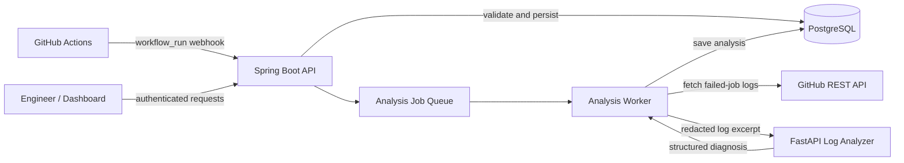

# DevOps Failure Intelligence Platform (DFIP)

> Turn failed GitHub Actions runs into actionable, searchable incident diagnoses.

[](https://openjdk.org/)
[](https://spring.io/projects/spring-boot)
[](https://www.python.org/)
[](https://fastapi.tiangolo.com/)
[](https://www.postgresql.org/)
[](https://www.docker.com/)

DFIP is a DevOps automation portfolio project that captures failed GitHub Actions workflow runs, retrieves job logs, classifies common failure patterns, and stores diagnosis results so engineers can investigate incidents faster.

It is designed around a practical engineering problem: CI failures consume developer time, diagnostic information is scattered across workflow logs, and recurring failure patterns are often investigated repeatedly.

## Why this project?

When a CI workflow fails, an engineer often has to open GitHub Actions, locate the failed job, read a large log, determine the probable cause, and communicate the next action. DFIP aims to streamline this first-response workflow by collecting failure events and producing a structured diagnosis.

**Project goal:** reduce manual triage effort and make common CI failures easier to understand. The project does not claim to eliminate failures or replace engineering judgment.

## Key capabilities

- **Webhook ingestion:** receives GitHub workflow events and verifies webhook signatures.
- **Duplicate delivery protection:** records delivery identifiers to avoid processing the same webhook repeatedly.
- **Failure tracking:** persists workflow-run information and analysis jobs in PostgreSQL.
- **Log collection:** retrieves failed-job logs through the GitHub API when credentials and permissions are configured.
- **Secret-aware processing:** applies basic redaction to likely credentials before sending logs to the analyzer. This is best-effort protection, not a guarantee that all secrets will be detected.
- **Rule-based diagnosis:** uses a Python/FastAPI analyzer to classify common log patterns and return a structured analysis.
- **Incident API:** exposes stored incident and diagnosis information through Spring Boot endpoints.
- **Retry handling:** retries queued analysis work with a bounded attempt count.
- **Local development:** Docker Compose is provided to run the supporting services together.
- **Database migrations:** Flyway manages schema evolution.

## Architecture



### Components

| Component | Responsibility |
| --- | --- |
| Spring Boot backend | Webhook verification, workflow persistence, job orchestration, incident endpoints, authentication |
| Python analyzer | Rule-based log classification and structured diagnosis responses |
| PostgreSQL | Workflow runs, incident records, webhook deliveries, and analysis-job state |
| GitHub REST API | Failed-job and log retrieval |
| Docker Compose | Local multi-service development environment |
| Flyway | Versioned database schema migrations |

## Technology stack

- **Backend:** Java 21, Spring Boot, Spring Data JPA, Spring Web
- **Analysis service:** Python, FastAPI, Pydantic
- **Database:** PostgreSQL, Flyway
- **Integration:** GitHub Actions webhooks and GitHub REST API
- **Infrastructure:** Docker, Docker Compose
- **Quality:** Python unit tests and Java tests (run status depends on the environment)

## Repository layout

```text
devops-failure-intelligence/
├── backend/                 # Spring Boot API and background analysis worker
├── analyzer/                # Python/FastAPI log classifier
├── docs/                    # Architecture and implementation documentation
├── docker-compose.yml       # Local service orchestration
├── render.yaml              # Render Blueprint configuration
├── .env.example             # Environment-variable template (no real secrets)
└── README.md
```

Exact paths may evolve as implementation grows.

## Getting started

### Prerequisites

Install:

- Java 21
- Maven 3.9+
- Python 3.11+ (use the version specified by the analyzer configuration if different)
- Docker Engine and Docker Compose
- A GitHub repository with Actions enabled for webhook testing

### 1. Configure environment variables

Copy the sample environment file:

```bash
cp .env.example .env
```

On Windows PowerShell:

```powershell
Copy-Item .env.example .env
```

Fill in local development values for the variables documented in `.env.example`. Typical settings include:

- `GITHUB_WEBHOOK_SECRET`: secret used to verify GitHub webhook signatures
- `DFIP_GITHUB_API_TOKEN`: GitHub token with the minimum permissions needed to read Actions workflow/job details
- `DFIP_INCIDENT_API_TOKEN`: bearer token for protected incident API endpoints
- Database credentials
- Analyzer service URL

Use least-privilege GitHub credentials. Do not commit `.env`, access tokens, webhook secrets, or production credentials.

### 2. Start services with Docker Compose

From the repository root:

```bash
docker compose up --build
```

Review `docker-compose.yml` and `.env.example` for the service names and exposed ports used by your checkout. Startup depends on the environment variables being set correctly.

### 3. Run analyzer tests

```bash
cd analyzer
python -m pip install -r requirements.txt
pytest -q
```

### 4. Run the backend tests

From the backend directory:

```bash
cd backend
mvn test
```

The Java build and tests should be run locally or in CI before treating a build as validated.

## GitHub webhook setup

1. Open the test repository's **Settings → Webhooks**.
2. Add the public URL for the Spring Boot webhook endpoint (see the backend controller and configuration for its exact path).
3. Set a long, random webhook secret matching `GITHUB_WEBHOOK_SECRET`.
4. Select the **Workflow runs** event.
5. Save the webhook and inspect the recent delivery history.
6. Trigger a test workflow failure, then confirm the run is stored, log analysis completes, and an incident is available through the authenticated API.

For a public deployment, use HTTPS and a narrowly scoped GitHub credential. Test against a dedicated repository before connecting production repositories.

## API overview

The API is implemented in the Spring Boot backend. Use the controller classes as the source of truth for the exact route names and response schema.

Expected functional areas include:

- GitHub webhook ingestion
- Listing stored incidents
- Viewing an incident and its diagnosis
- Health/readiness checks, where configured

**Incident API security:** provide the configured bearer token in the `Authorization` header:

```http
Authorization: Bearer <DFIP_INCIDENT_API_TOKEN>
```

Do not expose incident endpoints to the public internet without authentication and appropriate network controls. The webhook's HMAC signature verification is separate from incident API authentication.

## Failure-analysis approach

The analyzer uses deterministic rules to recognize common CI log patterns and return a structured diagnosis. Depending on the matched pattern, results can include a failure category, explanation, confidence or severity fields, and suggested next checks.

This is an initial diagnostic aid rather than an autonomous remediation engine. Rule coverage is limited; unmatched or ambiguous logs may produce a generic result, and engineers should verify recommendations against the actual workflow and code.

## Testing and validation

Recommended verification sequence:

1. Run Python analyzer tests.
2. Run `mvn test` for the Java backend.
3. Build and start the full stack with Docker Compose.
4. Verify invalid webhook signatures are rejected.
5. Deliver the same webhook twice and verify deduplication.
6. Confirm only relevant completed failure events enqueue analysis.
7. Confirm failed-job logs are retrieved and redacted before analysis.
8. Verify analysis jobs retry only within the configured bound.
9. Verify incident endpoints reject missing or invalid bearer tokens.
10. Run a real test workflow and follow the event through to the stored diagnosis.

Do not publish passing status badges or claim an end-to-end test passed until the corresponding workflow or test result confirms it.

## Deployment

A Render Blueprint file is included to describe a deployment shape. Before deploying:

- Review `render.yaml` against the exact application start commands and service paths.
- Configure all secrets as Render environment variables.
- Use a persistent managed PostgreSQL database for any environment where data must survive restarts.
- Confirm the analyzer URL, database connection settings, migrations, health checks, and resource limits.
- Configure the GitHub webhook only after the backend has a reachable HTTPS endpoint.
- Run a deliberate failure workflow and validate the diagnosis end to end.

**Deployment status:** this README describes the deployment approach; it does not imply that a live Render service is already running.

## Security notes

- Never commit real secrets, access tokens, or production environment files.
- Use least-privilege GitHub credentials and rotate exposed secrets immediately.
- Redaction is best-effort; logs may still contain sensitive information. Limit retention and access accordingly.
- Restrict incident APIs with authentication and network controls.
- Keep dependencies patched and review analyzer inputs as untrusted data.
- Use a dedicated repository for initial webhook and failure-injection tests.

## Roadmap

- [ ] Validate full Java build and test suite in CI
- [ ] Add an end-to-end integration test using a disposable PostgreSQL database
- [ ] Improve durable worker claiming and recovery after process restarts
- [ ] Expand log classifiers with tested examples and confidence evaluation
- [ ] Add repository-level access controls and incident search/filtering
- [ ] Add metrics and structured observability for worker retries and analyzer latency
- [ ] Validate the Render deployment and document its live URL when available
- [ ] Add a user-facing incident dashboard

## Contributing

Contributions and issue reports are welcome. Please include a reproducible scenario, relevant sanitized logs, expected behavior, and actual behavior. Never include credentials or raw logs that contain secrets.

1. Fork the repository.
2. Create a focused feature branch.
3. Add or update tests.
4. Run the relevant test suites.
5. Open a pull request describing the change and its validation.

## License

A license has not yet been selected for this repository. Until a license is added, assume that standard copyright applies and reuse is not automatically permitted.

---

Built as a practical portfolio project exploring DevOps automation, CI failure triage, webhook-driven systems, API integration, and incident analysis.
